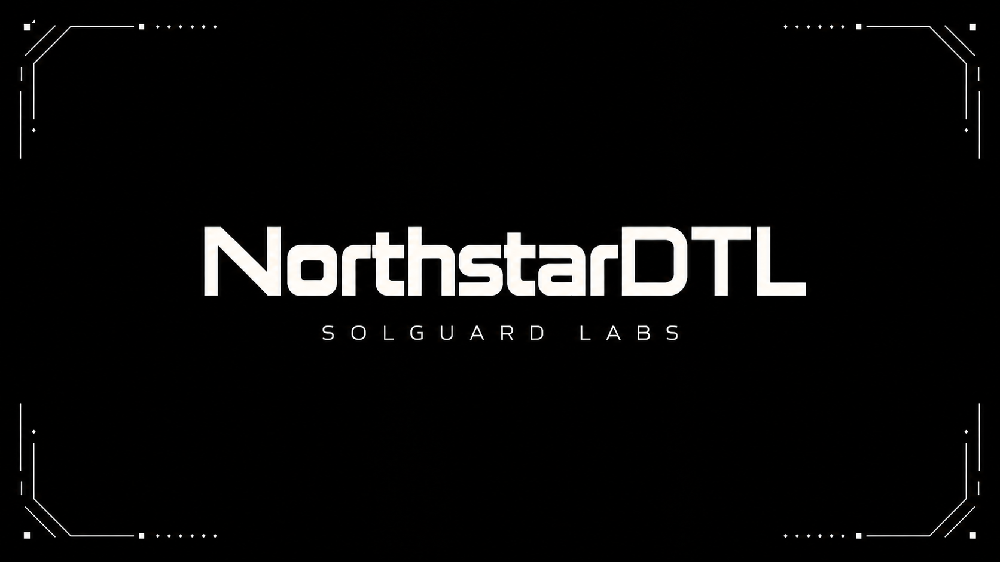
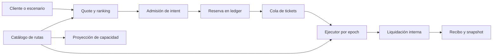

# NorthstarDTL



NorthstarDTL es un router de liquidez Go para intercambios entre activos mediante rutas RFQ y pools internos. Admite intents, reserva saldo fuente, ordena tickets para ejecución diferida y publica recibos y snapshots contables. Incluye API HTTP local y un runner de escenarios JSON; no transmite operaciones a una red ni custodia fondos externos.

## Arquitectura



`src/routing` gestiona catálogo y scoring; `src/settlement` coordina cola y ejecución; `src/ledger` mantiene balances; `src/api` expone el servicio; `src/scenario` reproduce flujos deterministas. La nueva vista `GET /capacity` ofrece headroom de exposición y liquidez de destino bajo un recorte hipotético del 15 %, sin modificar la admisión ni la liquidación.

## Inicio rápido

Requiere Go 1.22+, Node.js 24+ y npm.

```bash
npm ci
go run ./cmd/northstardtl run tests/fixtures/settlement.json
go run ./cmd/northstardtl serve --addr 127.0.0.1:8091
bash scripts/ci.sh
```

En otra terminal, `curl http://127.0.0.1:8091/capacity` devuelve la proyección de las rutas. También están disponibles `GET /snapshot`, `POST /quote`, `POST /submit`, `POST /execute` y `POST /route`. Las solicitudes de cambio de ruta afectan solo al proceso local.

## Modelo económico

Una cotización registra `grossOut = floor(amountIn × ratePpm / 1.000.000)` y `netOut = max(0, grossOut − penalizaciónCongestión)`. La comisión de ruta se reserva junto con el importe fuente. Los recibos indican la ruta cotizada y la ejecutora, el importe de salida, la comisión y el epoch ejecutado. El ledger conserva saldos disponibles y reservados por cuenta y activo; la auditoría de snapshots revisa saldos no negativos y límites de exposición.

La proyección de capacidad mantiene unidades separadas: `sourceHeadroom` corresponde al activo fuente y `destinationStressLiquidity` al activo destino. No se suman ni comparan directamente. Para una ruta con 1.200.000 unidades de liquidez destino, el recorte del 15 % produce 1.020.000 unidades bajo estrés. Es una métrica de observabilidad, no una autorización de pago.

## Documentación

- [Arquitectura y estados](docs/arquitectura.md)
- [Modelo económico y capacidad](docs/modelo-economico.md)
- [API y operación](docs/api-operacion.md)
- [Política de seguridad](SECURITY.md)
- [Historial de cambios](CHANGELOG.md)

La suite combina `go test ./...`, `go vet ./...`, typecheck y tests TypeScript, Prettier y comprobación de formato Go. El tag anotado `v1.0.0`, la rama `production` y el release `Production 1.0.0` identifican el mismo commit una vez publicados.
