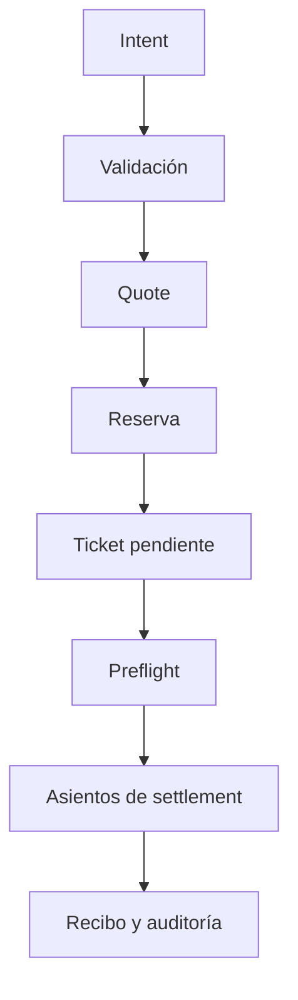

# Política de seguridad

## Modelo de revisión

NorthstarDTL procesa intents, cotizaciones, reservas y tickets de liquidación en memoria. La superficie incluye el catálogo de rutas, cambios operativos, límites de exposición, balances del ledger, cola, API HTTP y serialización JSON. El servicio distribuido es local; no gestiona claves ni conexiones externas.

| Control               | Señal                                        | Límite                                   |
| --------------------- | -------------------------------------------- | ---------------------------------------- |
| Validación de intent  | Par, importe y límites declarados            | No certifica precio de mercado           |
| Admisión y reserva    | Saldo fuente retenido para ticket            | Requiere vigilancia hasta ejecución      |
| Preflight de ruta     | Estado, exposición y liquidez disponible     | Es una comprobación puntual              |
| Auditoría de snapshot | Saldos, reservas y exposición                | No sustituye revisión económica por ruta |
| Capacidad bajo estrés | Headroom fuente y liquidez destino recortada | Solo observabilidad, no bloqueo          |

## Validación automatizada

`bash scripts/ci.sh` comprueba Go format, tests Go, `go vet`, typecheck TypeScript, tests de integración, Prettier y métrica de líneas. Dependabot cubre Go modules, npm y GitHub Actions. Una suite verde indica que se ejecutaron esos controles, no una garantía de ausencia de fallos.

## Reporte responsable

Utiliza el canal privado de avisos de seguridad de GitHub del repositorio, si está habilitado. Evita publicar detalles explotables en issues o PR abiertos. Adjunta commit, intent/fixture mínimo, ruta y epoch, balances iniciales/finales, resultado observado y esperado e impacto económico. No adjuntes secretos ni datos de terceros. La revisión de una alerta debe reproducir el caso sobre el commit indicado y distinguir fallo de configuración de cambio de estado del ledger.
