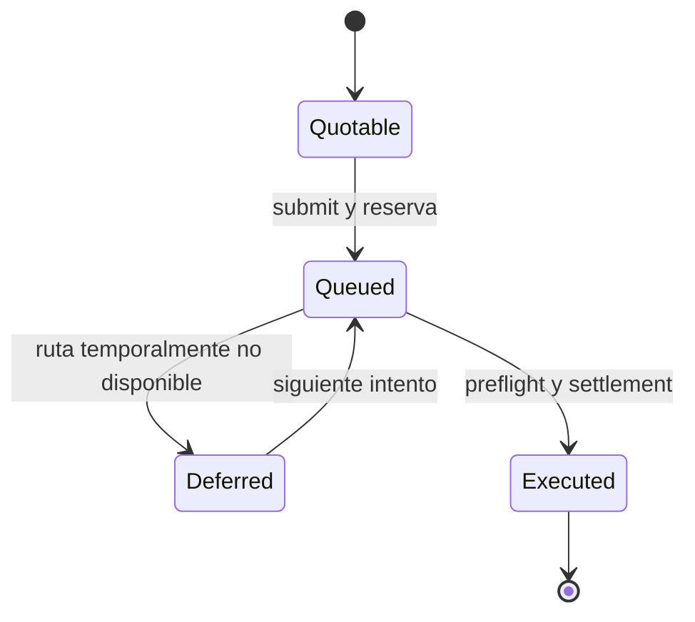

# Arquitectura y estados

El servicio crea un catálogo de rutas y balances iniciales. Un intent indica activo fuente y destino, cuentas, importe, mínimo de salida, comisión máxima y prioridad. El selector produce cotizaciones compatibles y elige una ruta admisible. La admisión reserva en la cuenta fuente `amountIn + routeFee`; el ticket queda en cola hasta `readyEpoch`.

En ejecución, el motor revisa estado operativo, par, exposición, liquidez destino y reserva fuente. Puede seleccionar una ruta alternativa del catálogo si la planificada deja de ser operativa. El recibo conserva ambos identificadores de ruta para trazabilidad y la cola elimina el ticket completado. Los asientos mueven saldo reservado fuente hacia tesorería y comisiones, y saldo destino desde el vault de la ruta ejecutora hacia la cuenta receptora.

`GET /snapshot` contiene balances, rutas, cola, recibos, eventos y observaciones de auditoría. `GET /capacity` lee el catálogo actual y calcula proyecciones sin generar eventos ni reservas. El runner `go run ./cmd/northstardtl run <fixture>` devuelve la secuencia de resultados y el snapshot final como JSON.

La API no implementa autenticación ni persistencia: se debe mantener enlazada a loopback en esta distribución local. Los identificadores de cuenta y ruta son etiquetas internas; no equivalen a direcciones on-chain.
