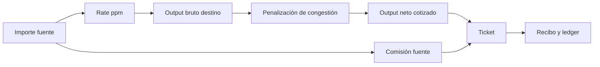

# Modelo económico y capacidad de ruta

El precio bruto se expresa en unidades mínimas del activo destino: `grossOut = floor(amountIn × ratePpm / 1.000.000)`. La penalización suma un componente proporcional al output bruto por `congestionBps` y otro proporcional al importe fuente por `congestionLevel`; cada componente redondea hacia abajo a enteros. `netOut = max(0, grossOut − penalty)`. La comisión fuente es `floor(amountIn × baseFeeBps / 10.000) + flatFee`.

Por ejemplo, con 200.000 unidades fuente, rate 990.000 ppm, congestión de 25 bps y nivel 5 bps, el output bruto es 198.000; las dos penalizaciones son 495 y 100; el neto calculado es 197.405. La comisión de 8 bps más 40 unidades fijas es 200 unidades fuente. Una ruta debe interpretarse con su estado y parámetros del epoch correspondiente.

`GET /capacity` publica por ruta `sourceExposure`, `sourceLimit`, `sourceHeadroom` y `destinationLiquidity`. La reserva destino estresada usa un recorte hipotético fijo de 1.500 bps: `floor(liquidity × 8.500 / 10.000)`. La implementación evita un producto intermedio grande separando cociente y resto antes de multiplicar. `destinationStressLoss` es la diferencia con la liquidez observada.

No existe un único número de capacidad que combine `sourceHeadroom` y `destinationStressLiquidity`: son activos diferentes y requieren una cotización para convertirse. El indicador `admissionOpen` refleja el estado operativo actual, no garantiza que un intent concreto supere todos los filtros.
